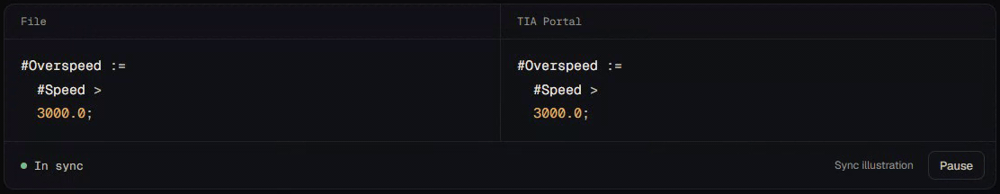
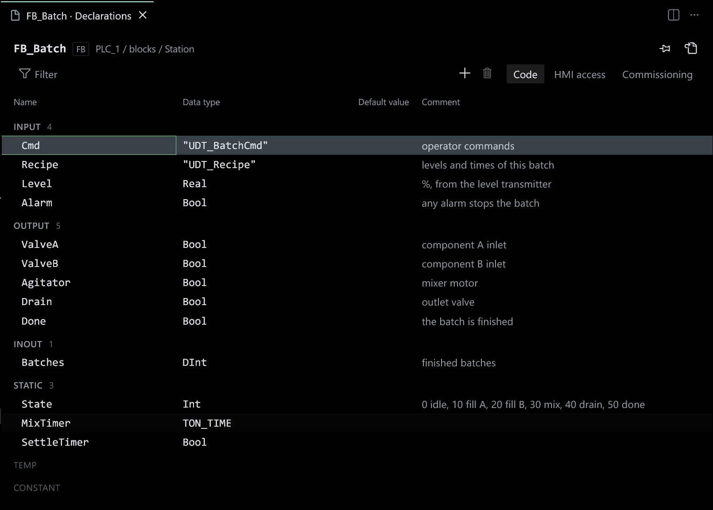
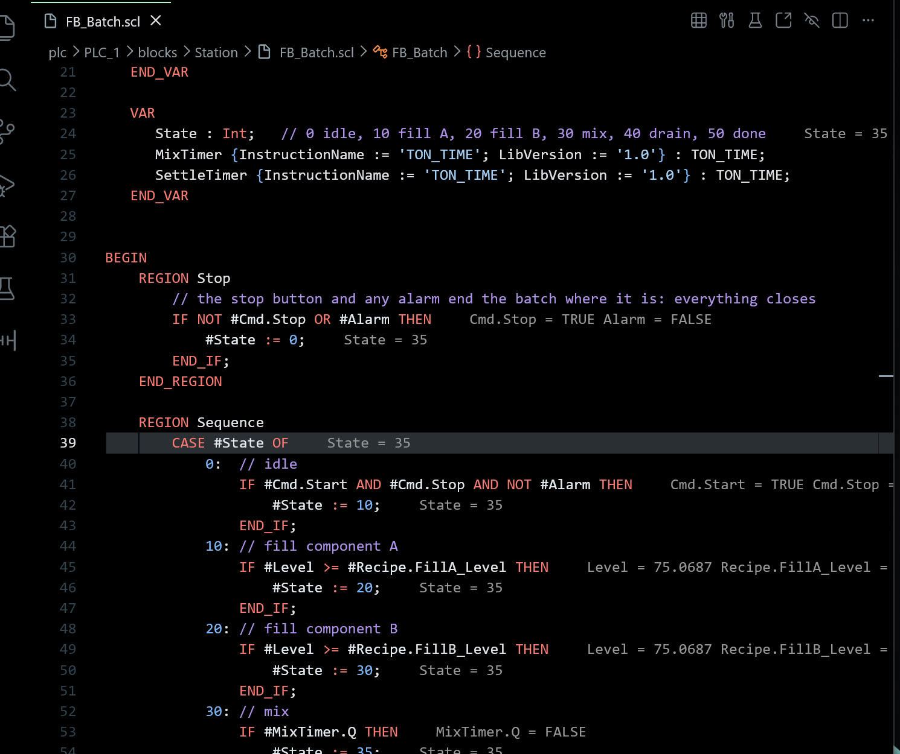
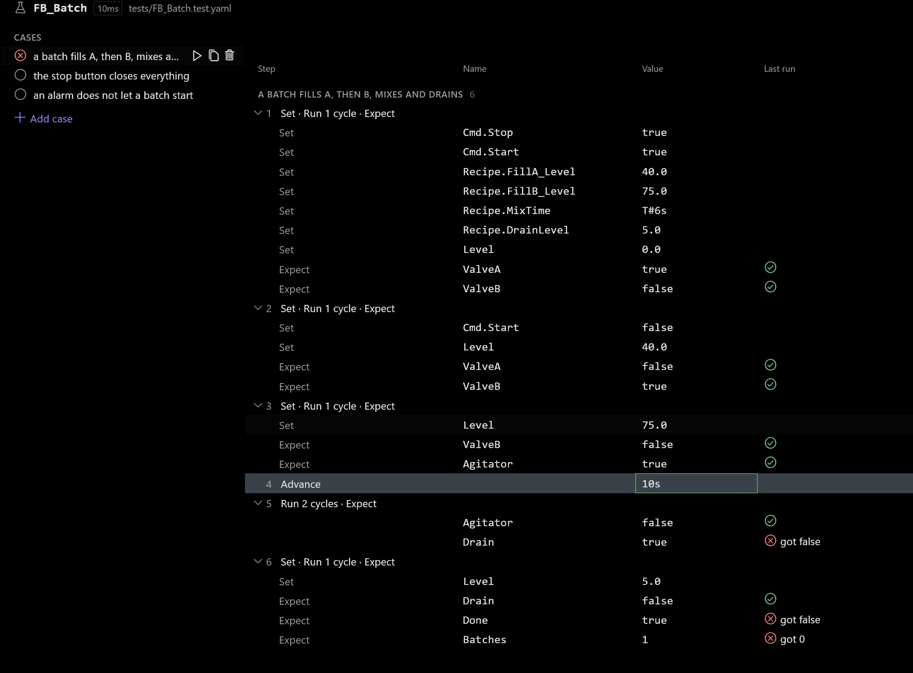
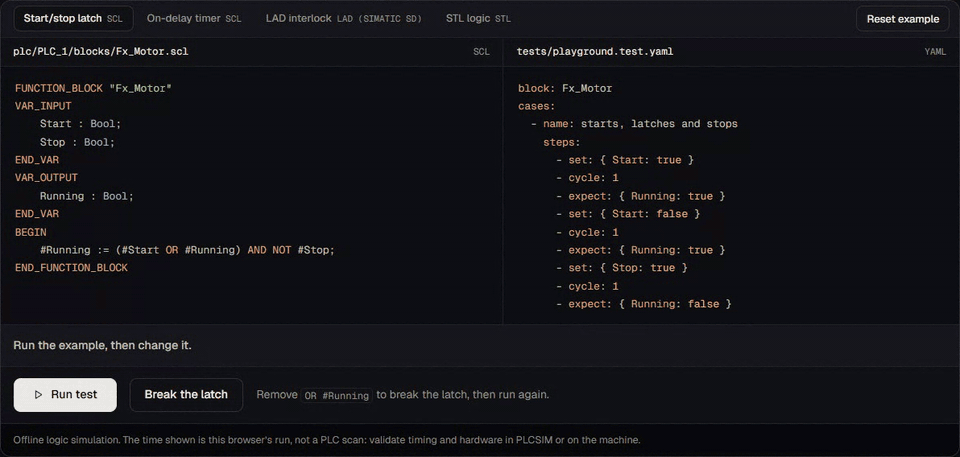

<p align="center">
  <picture>
    <source media="(prefers-color-scheme: dark)" srcset="site/assets/logo-dark.png" />
    
  </picture>
</p>

<p align="center">
  <a href="https://sa1ntsinner.github.io/rung/"></a>
  &nbsp;
  <a href="https://marketplace.visualstudio.com/items?itemName=sa1ntsinner.rung-scl"></a>
  &nbsp;
  <a href="LICENSE"></a>
  &nbsp;
  <a href="CHANGELOG.md"></a>
</p>

<p align="center">
  
</p>

**rung** puts a Siemens S7 project in your code editor. You write SCL and LAD as files in VS Code, Zed or Neovim, test them on your PC or in CI, and rung keeps the TIA Portal project in step both ways.

<table>
  <tr>
    <td width="50%"></td>
    <td width="50%"></td>
  </tr>
  <tr>
    <td width="50%"></td>
    <td width="50%"></td>
  </tr>
</table>

Try a test in your browser on the [playground](https://sa1ntsinner.github.io/rung/#play).

## Install

```bash
code --install-extension sa1ntsinner.rung-scl
```

The extension brings rung with it. Run **rung: Open TIA Project…** and pick your `.ap19`, `.ap20` or `.ap21`. Your Windows user has to be in the group "Siemens TIA Openness"; `rung check` tells you what is missing.

<details>
<summary>Command line</summary>

```sh
npm i -g @rung-plc/cli                  # or a zip from the releases
rung init --project D:\TIA\Line3.ap20   # link this folder to the project
rung pull                               # blocks, types and tag tables as files
rung writes on                          # let your edits go to TIA Portal
rung watch                              # keep both sides in step
```

</details>

<details>
<summary>Zed, Neovim, Open VSX</summary>

The Zed extension and `rung.nvim` use the same language server. The VS Code extension is also on [Open VSX](https://open-vsx.org/extension/sa1ntsinner/rung-scl) for VSCodium and Cursor.

</details>

<details>
<summary>Coding agents</summary>

`rung setup` connects Claude Code, Codex, Cursor, Gemini CLI and others to rung's MCP server and skills. Agents read, edit and test the files; a person starts every download.

</details>

<details>
<summary>CI</summary>

```yaml
- uses: sa1ntsinner/rung@v1   # runs rung test; a failing step shows on its line in the pull request
```

Tests run on rung's simulator, so the runner needs no TIA Portal and can be Linux.

</details>

## What you get

1. Each block, data type and tag table is a file you can diff, review and keep in git.
2. When you save, TIA Portal compiles the block, and its errors appear on the line they belong to.
3. A change made in TIA Portal comes back to the file. If you both changed it, rung merges SCL by line and LAD by network.
4. You test in YAML: set the inputs, run cycles, expect the outputs. A debugger steps through SCL and shows why a value is what it is.
5. Online with an S7-1500, the editor shows live values beside the code and reads watch tables, alarms and the diagnostic buffer.

Full list and limits: [capabilities](docs/capabilities.md). Setup: [quickstart](docs/quickstart.md). Everything else: [docs](docs).

## Careful by default

Only Siemens Openness talks to TIA Portal. Deleting a file never deletes a block. A person starts every [download](docs/downloads.md), and `RUNG_READ_ONLY=1` stops every change to the PLC and the project for a machine you must not touch.

## Common questions

**Do I still need TIA Portal?**  
Yes, your own licensed TIA Portal V18, V19, V20 or V21 for sync, hardware and download. The language server, the simulator and `rung test` work without it.

**Does it run on Linux or macOS?**  
The editor and the tests do. Sync needs Windows; rung can reach a Windows PC [over ssh](docs/remote.md).

**CODESYS?**  
CODESYS V3.5 projects sync too, and TwinCAT 3 sources work with the editor and the tests.

## License

The core is BUSL-1.1, free for individuals, education, non-commercial open source and organizations with up to three users, and each release becomes Apache 2.0 after three years. Larger teams take [rung Pro](docs/pricing.md), €49 per user and month. The extensions, grammar, protocol client and file format are MIT. Questions: [rungprojectplc@gmail.com](mailto:rungprojectplc@gmail.com).

<sub>rung is not affiliated with Siemens AG. TIA Portal and SIMATIC are trademarks of Siemens AG. Working on rung: see [CONTRIBUTING.md](CONTRIBUTING.md).</sub>
